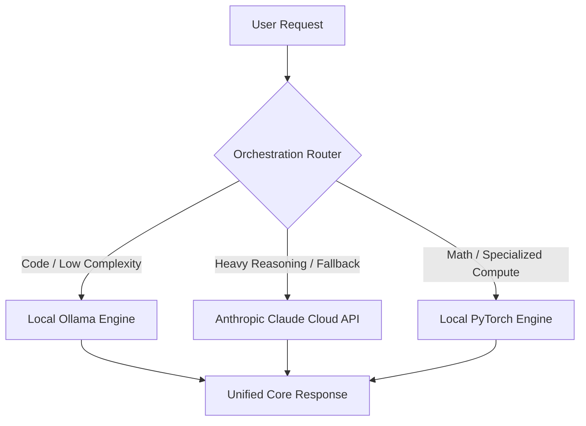

<div align="center">
  
</div>

[](https://github.com/tariqansari68/LuLuFusionAI/actions/workflows/tests.yml)

A hybrid, high-performance AI engine combining native PyTorch transformer architectures, localized Ollama orchestration, and advanced Anthropic Claude cloud capabilities into a single, unified interface.

## Features
- **Local PyTorch Tracking:** Built on native torch tensor operations for low-latency sequence modeling.
- **Ollama Orchestration:** Local model management and GGUF orchestration layer.
- **Anthropic Hybrid Intelligence:** Cloud failover module to route complex workflows directly to Claude 3.5 Sonnet.
- **Unified AI Interface:** Standardizes diverse backend models into a uniform data response structure.
- **Secure Isolation:** Environment masking prevents API keys or local weights from leaking online.
  
## System Architecture



## Getting Started

### 1. Clone the Repository
```bash
git clone https://github.com
cd LuLuFusionAI
```

### 2. Install Dependencies
```bash
pip install -r requirements.txt
```

### 3. Setup Secret Keys
Create a `.env` file in the root directory and paste your Anthropic credential:
```text
ANTHROPIC_API_KEY=your_secret_api_key_here
```

---

## Running the Engine

### Execute Automated Test Suite
Run the offline-safe testing framework containing mock-verified token processing loops:
```bash
pytest test_agent.py -v
```

### Run Orchestrated Pipeline
Execute the multi-tiered model routing layer, hardware checks, and text processing pipelines:
```bash
python train.py
```

### Local GGUF Agent Creation
Build your localized model wrapper via Ollama:
```bash
ollama create lulufusion -f ./Modelfile
ollama run lulufusion
```

---

## Engineering & Design Decisions

- **Unified Abstraction Contracts:** Forces external cloud endpoints, internal HTTP servers, and raw PyTorch tensor arrays to communicate through an identical execution design pattern.
- **Cost vs. Capability Optimization:** Automatically offloads basic tasks onto edge hardware, saving your cloud API budget for high-reasoning tasks.
- **Automated Failover Handling:** Gracefully catches hardware failures, local offline states, or out-of-memory errors and shifts tasks directly to cloud backups.
- **Resource-Agnostic Processing:** Integrated automated hardware tensor runtime detection to dynamically scale operations across CUDA, MPS (Apple Silicon), or basic CPU loops.

---

## API & Code Reference

### Orchestrated Router Invocation
```python
from claude_agent import OrchestrationRouter, RoutingConfig, ClaudeCloudProvider, OllamaLocalProvider

# 1. Initialize active engine blocks
providers = {
    "claude-3-5-sonnet": ClaudeCloudProvider(),
    "qwen3-coder:latest": OllamaLocalProvider(model_name="qwen3-coder:latest")
}

# 2. Build custom runtime conditions
config = RoutingConfig()
config.add_rule(lambda prompt: "qwen3-coder:latest" if "code" in prompt.lower() else None)

# 3. Instantiate and run unified router pipeline
router = OrchestrationRouter(providers, routing_config=config, fallback_model="claude-3-5-sonnet")
response = router.execute("Write a clean python data loop script.")

print(f"Engine Used: {response.model_used}")
print(f"Output text: {response.text}")
```

## Future Roadmap
- [ ] Implement local vector embeddings using FAISS for private document ingestion.
- [ ] Add an automated benchmarking script to measure tokens-per-second performance metrics.
- [ ] Implement asynchronous model evaluation using `asyncio` for non-blocking operations.

## License
This project is licensed under the MIT License - see the LICENSE file for details.
