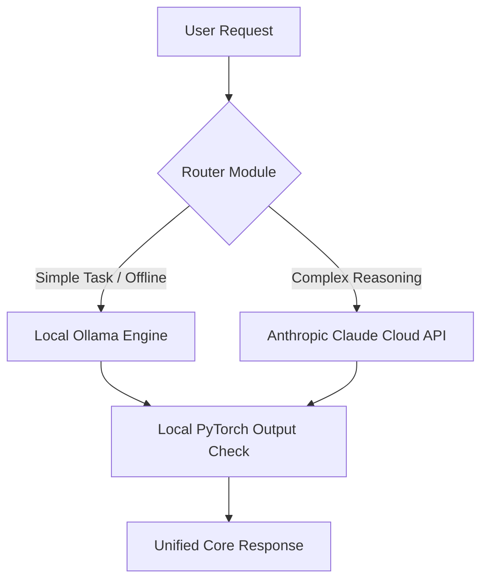

<div align="center">
  
</div>


[](https://github.com/tariqansari68/LuLuFusionAI/actions/workflows/tests.yml)

A hybrid, high-performance AI engine combining native PyTorch transformer architectures, localized Ollama orchestration, and advanced Anthropic Claude cloud capabilities.

## Features
- **Local PyTorch Tracking:** Built on native torch tensor operations for low-latency sequence modeling.
- **Ollama Orchestration:** Local model management and GGUF orchestration layer.
- **Anthropic Hybrid Intelligence:** Cloud failover module to route complex workflows directly to Claude 3.5 Sonnet.
- **Secure Isolation:** Environment masking prevents API keys or local weights from leaking online.
- 
## System Architecture



## Getting Started

### 1. Clone the Repository
```bash
git clone https://github.com
cd LuLuFusionAI
```

### 2. Install Dependencies
```bash
pip install -r requirements.txt
```

### 3. Setup Secret Keys
Create a `.env` file in the root directory and paste your Anthropic credential:
```text
ANTHROPIC_API_KEY=your_secret_api_key_here
```

## Running the Engine

### Local Hardware Check
Verify your local acceleration hardware (CUDA, MPS, or CPU) is detected:
```bash
python train.py
```

### Local Model Orchestration
Build and run your localized GGUF agent using Ollama:
```bash
ollama create lulufusion -f ./Modelfile
ollama run lulufusion
```

### Cloud Agent Execution
Send a complex reasoning request to the Anthropic cloud pipeline:
```bash
python claude_agent.py
```

## Engineering & Design Decisions

- **Hybrid Failover Architecture:** Implemented a routing layer that switches between low-latency local inference (Ollama) and high-reasoning cloud pipelines (Anthropic) based on prompt complexity.
- **Strict Security Boundaries:** Masked infrastructure API keys using decoupled environment states (`.env`) to ensure zero-leak public deployment profiles.
- **Resource-Agnostic Processing:** Integrated automated hardware tensor runtime detection to dynamically scale operations across CUDA, MPS (Apple Silicon), or basic CPU loops.

## API & Code Reference

### Claude Agent Routing
```python
from claude_agent import ask_claude

# Returns plain text string response from Claude 3.5 Sonnet
response = ask_claude(prompt="Your complex prompt here")
print(response)
```

## Future Roadmap
- [ ] Implement local vector embeddings using FAISS for private document ingestion.
- [ ] Add an automated benchmarking script to measure tokens-per-second performance metrics.
- [ ] Expand the automated test suite to include API latency mock analysis.


## License
This project is licensed under the MIT License - see the LICENSE file for details.
